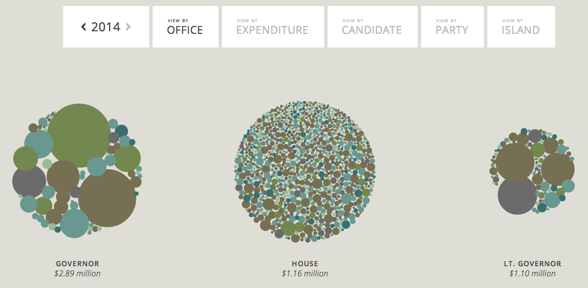
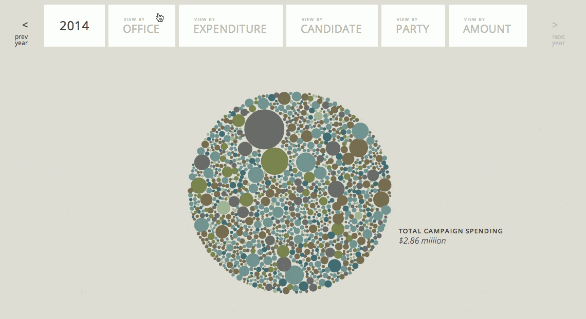
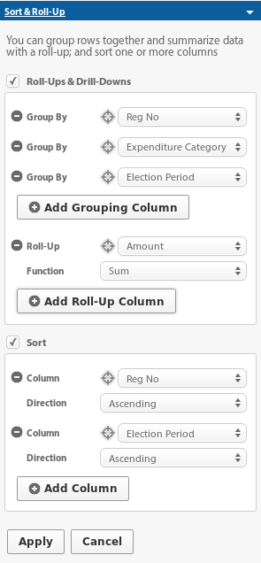
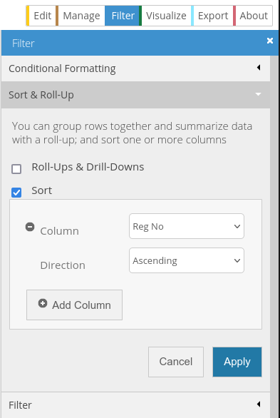

# Intro
This project is a vizualization of Hawaii Campaign Spending data for Candidates. It was initially created for [Civic*Celerator 2013](http://civic.celerator.org/).

[View Online](http://viz.hawaiicampaignspending.com)

Please note that this visualization is based on the official Hawaii Campaign
Spending data which you can find on data.hawaii.gov:
https://data.hawaii.gov/Community/Expenditures-Made-By-Hawaii-State-and-County-Candi/3maa-4fgr

But the data is actually pulled from a filtered/rolled-up view:
https://data.hawaii.gov/Community/Expenditures-Made-By-Hawaii-State-and-County-Candi/gvuk-nbsz/data

Also the Candidate Committee report is used:
https://hicscdata.hawaii.gov/dataset/Organizational-Reports-For-Hawaii-State-and-County/gkek-wbij

My sorted view of the dataset:
https://hicscdata.hawaii.gov/dataset/Organizational-Reports-For-Hawaii-State-and-County/8ry8-ip7m/data

To better understand the data you should take a look at the [Campaign Finance Data Primer](https://docs.google.com/document/d/1VC0of6-rLtFrLmpBS8xWDLjLvtoPOr9LBfDJLYy_4fw/edit)

# Development/Contributing

## Installation/Running

Requires Node (version in `.node-version`).

    npm install
    npm run dev

Visit the URL Vite prints (http://localhost:5173 by default). The source lives
in `src/`: pages at the top level, the visualization and styles in `src/app/`,
and files copied verbatim (data, images, vendored libraries) in `src/public/`.

## Getting a Socrata API key

After creating a filtered/rolled-up view as above

    curl 'https://hicscdata.hawaii.gov/api/api_keys' -i -X POST -H 'Content-Type: application/json'  -H 'Accept-Language: en-US,en;q=0.5' --compressed -H 'Pragma: no-cache' -H 'Cache-Control: no-cache' --data '{"keyName": "Example key."}' -u "$USERNAME@$PASSWORD"

Then put your api key username and password key in `.env` (based on `.env.sample`)

NOTE: The username is the `keyId` field and the password is the `keySecret` field

## Updating Data

In this project the data is updated manually rather than automatically fetched (this may change in the future).

    npm run update-data

This downloads the Socrata exports into `raw_data/` and writes the reshaped
data to `src/public/data/`. The durable assets page combines the live dataset
(reports from 2015 on) with `raw_data/durable_assets_2006-2013.json`, a
snapshot taken in 2014 that can't be re-downloaded. Reports filed during 2014
are in neither. Pass `-- --skip-download` to only reshape the files
already in `raw_data/`. Then commit the changes to the data (if any) and deploy.

## Deploying

Run the deploy script, which builds the site into `docs/` and stages it:

    ./deploy.sh

Then commit the changes. The site is served from the `docs/` folder of the master branch of the common cause repo: https://github.com/CommonCauseHawaii/campaign_spending

## Checking a change against the deployed build

`scripts/parity.mjs` drives two builds through the same interactions with a
seeded `Math.random` and compares bubble layout, visible text, Socrata requests,
console errors and screenshots. Serve the reference build (e.g. a checkout of
`docs/` from before the change) and the new one, then:

    mkdir -p /tmp/reference && git archive <old-commit> docs | tar -x -C /tmp/reference
    (cd /tmp/reference/docs && python3 -m http.server 8001) &
    npm run build && npx vite preview --port 4173 &
    npm run parity -- http://localhost:8001 http://localhost:4173

It uses Playwright's Chromium (`npx playwright install chromium`), or set
`CHROMIUM_PATH` to another Chromium binary.

## Contributing

If you'd like to contribute, simply fork the repo, push your commits, and submit your pull request.
